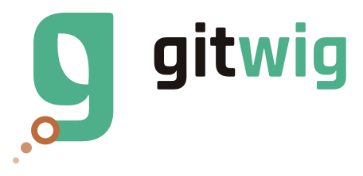

# Gitwig — Terminal Git UI & SourceTree Alternative (Built in Rust)

<p align="center">
  <picture>
    <source media="(prefers-color-scheme: dark)" srcset="resources/logo-dark.svg">
    
  </picture>
</p>

<p align="center">
  <a href="https://crates.io/crates/gitwig"></a>
  <a href="https://crates.io/crates/gitwig"></a>
  <a href="LICENSE"></a>
  <a href="https://gitwig.dev"></a>
  <a href="https://docs.gitwig.dev"></a>
  <a href="https://cli.masoko.net/tools/gitwig/"></a>
</p>

**Gitwig** (derived from **Git** + **Twig**, representing repository branches) is a lightweight, keyboard-driven **Terminal Git UI** (TUI) designed as a fast, minimal alternative to desktop Git GUI clients like **SourceTree** and terminal clients like **lazygit** and **gitui**. Built with Rust and `ratatui`, Gitwig presents all your Git repositories, worktrees, stashes, and branches in a clean, interactive bordered layout directly inside your terminal window.

🌐 **Website:** [gitwig.dev](https://gitwig.dev) · 📖 **Documentation:** [docs.gitwig.dev](https://docs.gitwig.dev)

---

## 💡 Why Gitwig?

Most terminal Git tools like `lazygit` and `gitui` focus on one repository at a time. **Gitwig** brings the multi-repository project overview of desktop Git GUIs like **SourceTree** straight into your terminal—pairing fast native Rust performance with full workspace inspection, branch graphs, GitHub PR/issue workflows, and an embedded shell in a single keyboard-driven interface.

---

## ✨ Key Features

- **Multi-Repository Workspace**: Monitor all your repos from one home screen with background auto-refresh, scheduled auto-fetch, pinning, favorites, card/compact/tile view modes, and persistent label project filters.
- **Full-Screen Detail View**: Inspect and act across dedicated tabs for Workspace (stage/unstage/diff/commit), Files tree with preview, Commit Graph, Branches, Tags, Remotes, Stashes, Worktrees, Submodules, Reflog, and Bisect.
- **Partial Stashing & Conflict Resolution**: Stash selected files, individual diff hunks, or single lines (`z`), and launch your configured external `git mergetool` directly from the TUI.
- **GitHub / Forge Integration**: View pull requests, issues, status checks, and reviews, check out PR branches, and post inline line review comments asynchronously.
- **Embedded Terminal Panel & Command Palette**: Toggle a persistent PTY shell docked inside the TUI (`t` / `Ctrl-T`) or fuzzy-search every available action and keybinding (`Ctrl-P`).
- **Global Search, Workspace Sync & Insights**: Search code across all tracked repositories (`Ctrl-F`), auto-discover repos in `watch_dirs`, manage Git LFS files, customize themes via TOML, and view a 52-week Usage Dashboard (`U`).

---

## 🚀 Quick Install

**Homebrew (macOS / Linux):**
```sh
brew tap tareqmy/tap
brew install gitwig
```

**Shell Script (macOS / Linux):**
```sh
curl -fsSL https://raw.githubusercontent.com/tareqmy/gitwig/master/scripts/install.sh | sh
```

**PowerShell (Windows):**
```powershell
irm https://raw.githubusercontent.com/tareqmy/gitwig/master/scripts/install.ps1 | iex
```

**Chocolatey (Windows):**
```cmd
choco install gitwig
```

**Cargo (Rust):**
```sh
cargo install gitwig
```

**Nix (Flake):**
```sh
nix run github:tareqmy/gitwig
```

Launch Gitwig with `gitwig` or the short alias `gtg`. See [Installation & Running](docs/installation.md) or [docs.gitwig.dev](https://docs.gitwig.dev) for full setup and uninstall instructions.

---

## 📸 Preview


*To play the interactive terminal recording locally:*
```sh
asciinema play resources/preview.cast
```

---

## 📖 Documentation

The complete documentation is available online at **[docs.gitwig.dev](https://docs.gitwig.dev)**.

You can also explore the raw markdown files below:

Explore the features, configuration, and controls of Gitwig:

- [🚀 Installation & Running](docs/installation.md)
- [✨ Features](docs/features.md)
- [⌨️ Keybindings](docs/keybindings.md)
- [📂 Item Status Indicators](docs/status_indicators.md)
- [🔍 Detail View](docs/detail_view.md)
- [🖥️ Panels & UI Windows](docs/panels.md)
- [🔧 Configuration](docs/configuration.md)
- [🎨 Font & Symbol Support](docs/font_support.md)

---

## 🤝 QA & Special Thanks

A huge thank you to the following friends who helped with Quality Assurance (QA) and testing to make Gitwig more robust:

- **Ehsanul Alam Sabbir** — [GitHub](https://github.com/easabbir) / [LinkedIn](https://www.linkedin.com/in/ehsanul-alam-sabbir/)
- **Fahim Rahman** — [GitHub](https://github.com/fahim-6/) / [LinkedIn](https://www.linkedin.com/in/fahim-rahman-4b333791/)

